<p align="center">
  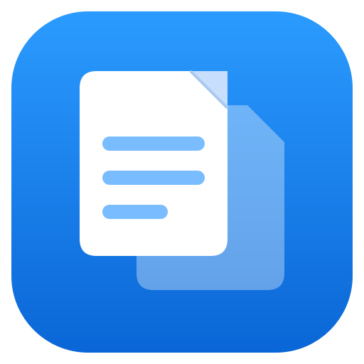
</p>

<h1 align="center">OpenFolio PDF Suite</h1>

<p align="center">
  Suite completa e open source de manipulação de PDF: mesclar, editar, redigir e assinar,<br>
  tudo rodando na sua máquina — sem enviar um arquivo sequer pra nuvem de ninguém.
</p>

---

## Índice

- [Visão geral](#visão-geral)
- [Por trás do projeto](#por-trás-do-projeto)
- [Funcionalidades](#funcionalidades)
- [Demonstração](#demonstração)
  - [Mesclando arquivos](#mesclando-arquivos)
  - [Comprimindo um PDF](#comprimindo-um-pdf)
  - [Marca d'água](#marca-dágua)
  - [Campos de formulário](#campos-de-formulário)
  - [Anotações sobre o visualizador](#anotações-sobre-o-visualizador)
  - [OCR (texto pesquisável)](#ocr-texto-pesquisável)
  - [Redigir e sanitizar](#redigir-e-sanitizar)
  - [Assinatura digital](#assinatura-digital)
- [Baixar (instalador pronto)](#baixar-instalador-pronto)
- [Requisitos](#requisitos)
- [Como instalar a partir do código-fonte](#como-instalar-a-partir-do-código-fonte)
- [Como rodar](#como-rodar)
- [Tecnologias utilizadas](#tecnologias-utilizadas)
- [Estrutura do projeto](#estrutura-do-projeto)
- [Testes](#testes)
- [Contribuição](#contribuição)
- [Licença](#licença)

## Visão geral

O OpenFolio PDF Suite é um aplicativo desktop (Windows/Linux/macOS, via PySide6) que reúne as
operações de PDF mais comuns — mesclar, dividir, comprimir, proteger, converter, preencher,
anotar, redigir, assinar — sem depender de ferramentas online, sem enviar seus arquivos para
servidor nenhum e sem paywall. Tudo roda localmente, na sua máquina.

<p align="center">
  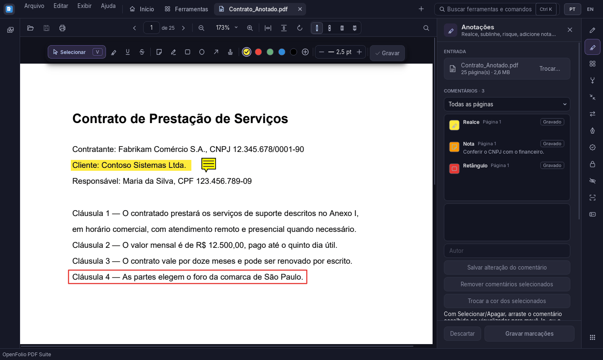
</p>

A navegação é feita por uma barra lateral com ícone e descrição de cada ferramenta. No centro
fica o visualizador — sempre visível, com miniaturas, marcadores e anexos ao lado, zoom
(também com Ctrl + roda do mouse), ajuste à largura ou à página, rotação da visualização,
rolagem contínua ou página única, busca que destaca todas as ocorrências e seleção de texto
com Ctrl+C. É nele que você desenha as anotações, marca as áreas de redação e posiciona o que
as ferramentas pedem (a área de um texto novo, de um link, de um campo de formulário, do corte
ou do selo da assinatura), arrastando sobre a página. Formulários são preenchidos ali mesmo, no
modo página única: os campos aparecem realçados, e um clique abre o campo de texto, marca a
caixa ou a opção, ou mostra a lista de opções; cada campo preenchido pode ser desfeito com
Ctrl+Z. Um aviso no topo indica quando o PDF está protegido, assinado, tem formulário ou
camadas. Se o PDF estiver protegido por senha, o próprio
visualizador pede a senha na hora de abrir.

O documento aberto é um documento de trabalho: as ferramentas aplicam o resultado nele, cada
operação pode ser desfeita (Ctrl+Z) e refeita (Ctrl+Y), e nada vai para o arquivo original
até você usar **Arquivo > Salvar** (ou Salvar como). O título da janela mostra um "*" enquanto
houver alterações não salvas, e o app pergunta antes de fechar ou trocar de documento. Para
gravar o resultado de uma ferramenta direto em outro arquivo, use "Procurar..." no campo de
saída dela. Páginas selecionadas nas miniaturas (Ctrl ou Shift + clique) podem ser usadas como
entrada da aba Páginas.

Dá para abrir um PDF arrastando-o para a janela, pelo menu **Arquivo > Abrir recente**, ou
pelo "Abrir com" do sistema (no Windows, o instalador oferece incluir o OpenFolio nessa lista).
O app lembra o idioma, a última pasta usada e os arquivos recentes. **Arquivo > Imprimir**
(Ctrl+P) imprime o documento de trabalho inteiro, um intervalo, a página atual ou as páginas
selecionadas nas miniaturas, com anotações e campos preenchidos, ajustando cada página ao
papel; PDFs cujo autor proibiu a impressão não são impressos.

As operações rodam em segundo plano: a janela continua respondendo, a barra de status mostra
o andamento e o botão "Cancelar" interrompe a operação sem deixar arquivo pela metade. Os
divisores entre a barra lateral, o visualizador e o painel podem ser arrastados, e o app
lembra o tamanho da janela. Erros inesperados ficam registrados em `openfolio.log`, na pasta
de dados do app (no Windows, `%LOCALAPPDATA%\OpenFolio\OpenFolio PDF Suite\logs`), para
anexar a uma issue.

## Por trás do projeto

Esse projeto segue um padrão que se repete nas coisas que eu construo: toda vez que preciso de
uma ferramenta, a primeira pergunta é se dá pra fazer uma versão que rode local, sem depender
de um servidor de terceiros guardando meus arquivos, sem assinatura mensal e, de preferência,
aberta pra quem quiser ler o código ou contribuir. O
[CofreDeSenhas](https://github.com/dcCarreto/CofreDeSenhas), por exemplo, nasceu da mesma
lógica: um gerenciador de senhas com cofre local criptografado (AES-256-GCM) em vez de um
serviço na nuvem guardando a chave de tudo.

Com o OpenFolio não foi diferente. Comecei pelo básico — mesclar, dividir, comprimir — e fui
adicionando ferramenta por ferramenta, sempre em uma branch separada e sempre com testes
cobrindo o comportamento esperado antes de considerar qualquer coisa pronta, até chegar num
visualizador integrado com anotação, OCR, redação real e assinatura digital de verdade. A
metodologia se repete em cada ferramenta nova: preferir uma biblioteca madura e bem mantida a
reinventar algo sensível a erro sutil — por isso a assinatura digital usa `pyhanko` e o OCR usa
o Tesseract, em vez de eu tentar resolver na unha algo onde um bug silencioso pode custar caro
(um PDF "assinado" que não valida, uma redação que deixa dado recuperável por baixo).

## Funcionalidades

| Seção | O que faz |
| --- | --- |
| 🆕 Criar PDF | Cria um novo PDF em branco, com uma ou mais páginas, no tamanho que você escolher |
| 📄 Mesclar | Combina vários PDFs em um único arquivo, na ordem que você definir |
| ✂️ Dividir | Separa um PDF em vários arquivos menores (uma ou N páginas por arquivo, ou um arquivo por marcador de nível superior do sumário) |
| 🔃 Páginas | Rotaciona, reordena, remove, insere ou substitui páginas de um PDF (inserção/substituição usando páginas de outro PDF). As páginas são contadas a partir de 1, como no visualizador, e aceitam intervalos como `1-3, 5, 8-` |
| 🔲 Organizar páginas | Grade de miniaturas do documento: arraste para reordenar, gire, duplique, exclua, insira páginas em branco ou extraia as selecionadas para outro arquivo. Antes de aplicar, Ctrl+Z desfaz cada mudança na grade; ao clicar em Aplicar, tudo entra no documento num passo só, que Ctrl+Z também desfaz |
| 🗜️ Comprimir | Reduz o tamanho de um PDF em três níveis: leve (sem perda), médio e forte (imagens reamostradas para 150 ou 100 DPI, pelo tamanho com que aparecem na página, e regravadas em JPEG; imagens sem cor passam a escala de cinza). Usa o Ghostscript, se você quiser e ele estiver instalado, e não grava nada se o arquivo não ficar menor |
| 🖼️ Converter | Converte entre PDF e imagens (com tamanho de página A4, Carta, Ofício ou o da imagem, margem, orientação da câmera e fundo branco em imagens transparentes), Word/Excel/PowerPoint e PDF (com o LibreOffice, também .doc, .xls, .ppt, .odt, .ods, .odp e .rtf), e XML e PDF (linhas longas quebradas com recuo) |
| 💧 Marca d'água | Adiciona um texto de marca d'água (opacidade, tamanho e rotação configuráveis) |
| 🔒 Proteger | Protege um PDF com senha (AES-256), define permissões granulares (impressão, edição, cópia, formulários) com senha de proprietário separada, ou remove a senha de um PDF protegido |
| 🏷️ Metadados | Lê e edita título, autor, assunto, palavras-chave e os aplicativos de origem de um PDF (também no XMP), e mostra as datas de criação e modificação |
| 🔢 Numeração | Adiciona números de página no rodapé (com página inicial configurável), numeração Bates (prefixo + sequência global, para uso jurídico), ou um texto livre de cabeçalho/rodapé (com placeholders `{page}`/`{pages}`) |
| 📜 PDF/A | Converte para PDF/A-1, 2 ou 3: remove o que a norma proíbe, embute o perfil de cor sRGB e sincroniza os metadados, e só declara a conformidade se fontes, transparência e estrutura passarem na verificação (senão, mostra o que falta e não grava nada). Com o Ghostscript, faz a conversão completa. A validação cobre esses requisitos e, com o veraPDF instalado, roda também a validação oficial |
| 📝 Extrair texto | Extrai todo o texto de um PDF para um arquivo `.txt` |
| 📷 Extrair imagens | Extrai as imagens embutidas nas páginas de um PDF, em seus formatos originais |
| 📐 Cortar/Redimensionar | Corta margens ou redimensiona as páginas de um PDF para um novo tamanho |
| ✏️ Editar | Substitui uma imagem já embutida por outra (mantendo posição e tamanho, sem distorcer), "edita" texto cobrindo uma área marcada no visualizador e reescrevendo por cima com fonte, tamanho e cores à escolha, com quebra de linha (achatando a página, como na redação), e adiciona, lista ou remove links (URL externa ou página do documento) |
| 🔖 Marcadores | Monta um sumário de navegação (outline) com título e página de destino |
| 🗂️ Camadas | Lista as camadas (Optional Content Groups) de um PDF, inclusive as desligadas por padrão, e alterna a visibilidade padrão de cada uma |
| 📎 Anexos | Lista, adiciona, remove ou extrai os anexos embutidos de um PDF (a extração nunca grava fora da pasta escolhida, mesmo que o nome do anexo tente) |
| 🧾 Campos de formulário | Adiciona campos de formulário **interativos** (texto, data, caixa de seleção, lista suspensa, lista de seleção ou grupo de opções) — o PDF resultante é preenchível em qualquer leitor. Também lista campos já existentes, exporta/importa dados preenchidos (CSV, Excel ou FDF) e achata o formulário (Fill & Sign simplificado) |
| 🖍️ Anotações | Realce, sublinhe, risque, adicione notas, desenhe à mão livre ou carimbe direto sobre a página, no próprio visualizador — com uma biblioteca de carimbos customizados (nome, texto e cor) salva localmente. Cada anotação leva autor e data. Também exporta os comentários já existentes no PDF para CSV ou Excel |
| 📏 Medição | Mede a distância entre dois pontos de um PDF, arrastando no visualizador central (mm, cm, polegadas ou pontos PDF) |
| 🔍 OCR | Reconhece o texto de páginas escaneadas (via Tesseract) e gera um PDF pesquisável, com o texto invisível ajustado à largura de cada palavra reconhecida (inclusive em páginas giradas). Aceita vários idiomas ao mesmo tempo, DPI configurável, corrige páginas digitalizadas de lado e também reconhece escaneados que têm um carimbo de texto |
| ⬛ Redigir/Sanitizar | Apaga áreas de um PDF de forma irreversível: a página marcada vira imagem, com as áreas pintadas de preto nos próprios pixels, e o resultado é conferido antes de ser salvo (funciona também em páginas giradas ou com área de corte). Procura um ou mais textos (sem diferenciar maiúsculas nem acentos, também quando o trecho quebra de linha) e detecta padrões sensíveis (CPF, CNPJ, e-mail, telefone, cartão de crédito ou regex personalizada), marcando todas as ocorrências para revisão antes de aplicar. A sanitização remove metadados, JavaScript (inclusive em ações de páginas, campos e links), ações que abrem arquivos ou programas ou enviam dados, e arquivos embutidos — e mostra o que foi removido |
| 🖋️ Preencher e assinar | Coloca texto, data, assinatura e iniciais na página, sem certificado: escolha o item e arraste no visualizador para marcar onde ele vai. A assinatura e as iniciais podem ser desenhadas com o mouse ou a caneta, ou vir de uma imagem PNG/JPEG, e ficam guardadas para as próximas vezes. Tudo entra no conteúdo da página num passo só, que Ctrl+Z desfaz |
| ✒️ Assinatura digital | Assina um PDF com selo visível e assinatura criptográfica de verdade (CMS/PKCS#7), usando um certificado .pfx real ou um certificado de teste gerado na hora. A verificação mostra se o conteúdo assinado está íntegro, se algo foi alterado depois da assinatura e se o certificado é confiável |
| ♿ Acessibilidade | Verifica um subconjunto de PDF/UA (idioma, título, árvore de estrutura, texto alternativo em figuras, ordem de tabulação, descrição dos campos) e corrige idioma, título e ordem de tabulação — não tagueia automaticamente, pelo risco de gerar uma estrutura malformada |
| 🆚 Comparar | Compara duas versões de um PDF: diff de texto por página, ou diff visual (imagem por página destacando em vermelho o que mudou) |
| 🗂️ Processar em lote | Aplica a mesma operação (comprimir, OCR, marca d'água, numerar páginas, proteger com senha ou converter para PDF/A-2b) a todos os PDFs de uma pasta. Os resultados vão para outra pasta, com o sufixo da operação no nome e sem sobrescrever nada; um arquivo que falha não interrompe os outros, e ao final a tabela e um relatório em CSV mostram o resultado de cada arquivo |

## Demonstração

As capturas abaixo foram feitas rodando a aplicação de verdade: arquivos de exemplo reais são
mesclados, comprimidos e processados, e os resultados (tamanho de arquivo, mensagens de sucesso)
vêm da execução real das operações — não são mockups.

### Mesclando arquivos

Três relatórios mensais são adicionados à lista, na ordem em que devem aparecer no PDF final, e
um arquivo de saída é escolhido:

<p align="center">
  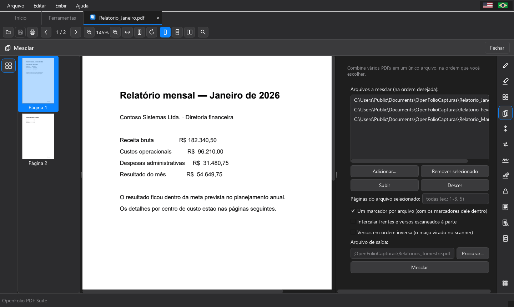
</p>

Ao clicar em **Mesclar**, os três arquivos são combinados em um único PDF de verdade:

<p align="center">
  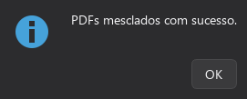
</p>

### Comprimindo um PDF

Um contrato de 25 páginas é escolhido como entrada:

<p align="center">
  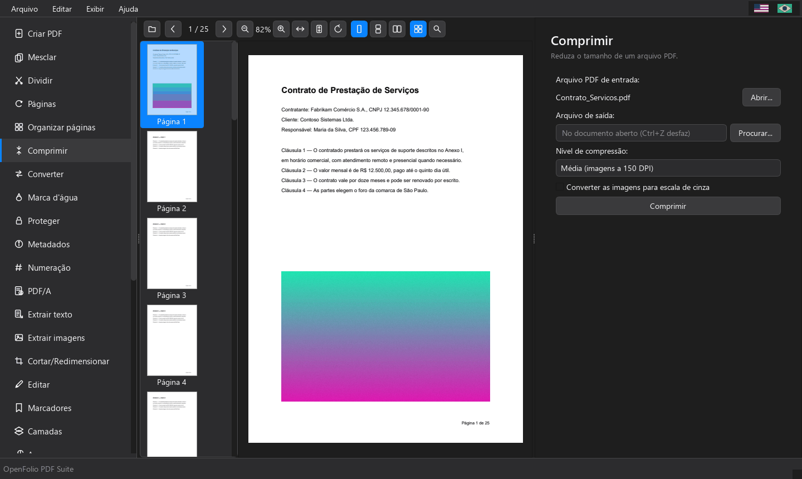
</p>

O resultado mostra o tamanho real antes e depois da compressão:

<p align="center">
  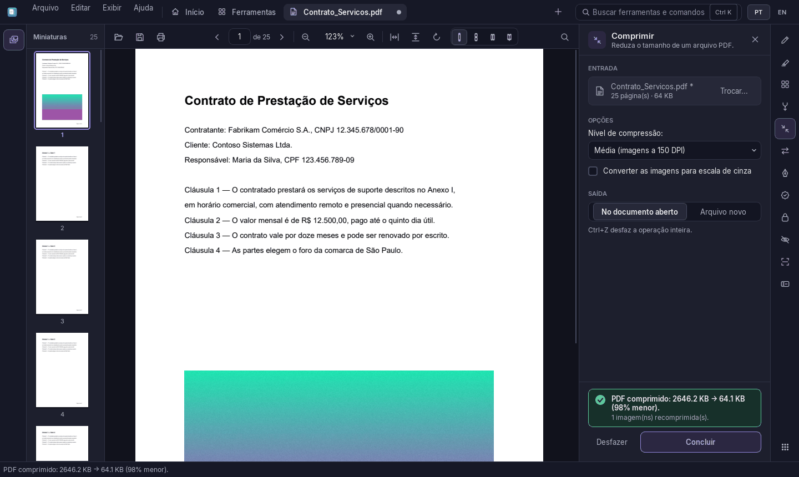
</p>

### Marca d'água

Texto, opacidade, tamanho de fonte e rotação são configuráveis antes de aplicar sobre todas as
páginas do PDF:

<p align="center">
  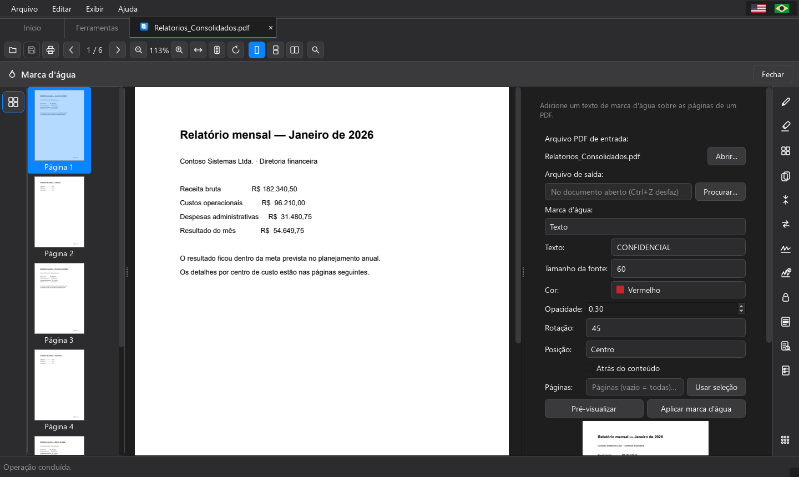
</p>

### Campos de formulário

Diferente de um texto carimbado na página, esta ferramenta cria um campo **AcroForm** de
verdade: o PDF resultante pode ser aberto em qualquer leitor (Adobe Reader, navegador, etc.) e o
campo pode ser clicado e preenchido normalmente.

<p align="center">
  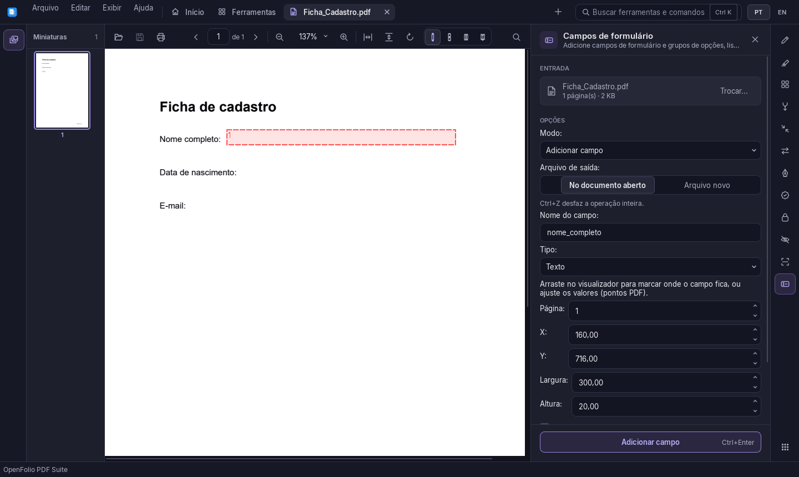
</p>

### Anotações sobre o visualizador

A ferramenta de realce está selecionada e o trecho "Cliente: Contoso Sistemas Ltda." foi
marcado direto na página, arrastando o mouse sobre o visualizador — sem precisar de um editor
separado:

<p align="center">
  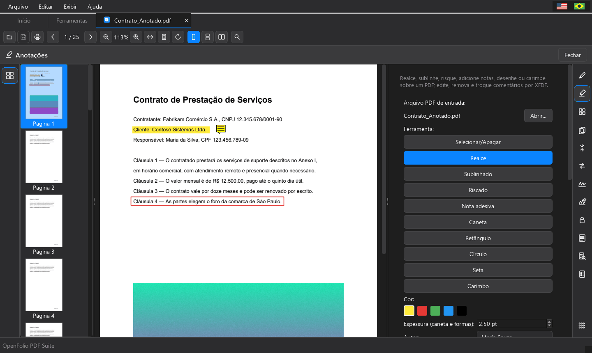
</p>

### OCR (texto pesquisável)

Um contrato gerado a partir de texto puro (sem camada pesquisável) é reconhecido pelo
Tesseract, que já foi detectado automaticamente com o idioma instalado:

<p align="center">
  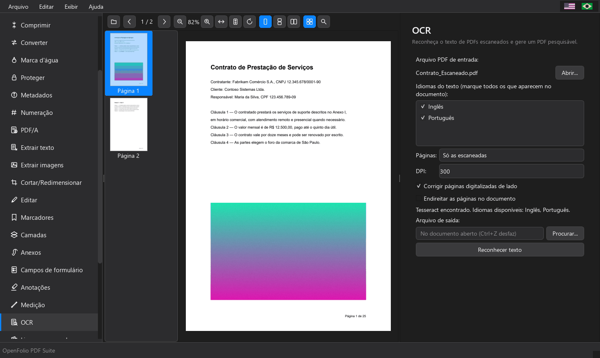
</p>

### Redigir e sanitizar

Uma linha inteira contendo o CPF do contratante é marcada no visualizador; ao aplicar a
redação, a página vira uma imagem com a área pintada de preto nos próprios pixels — não sobra
texto, vetor nem pixel original recuperável, e o resultado é conferido antes de ser salvo:

<p align="center">
  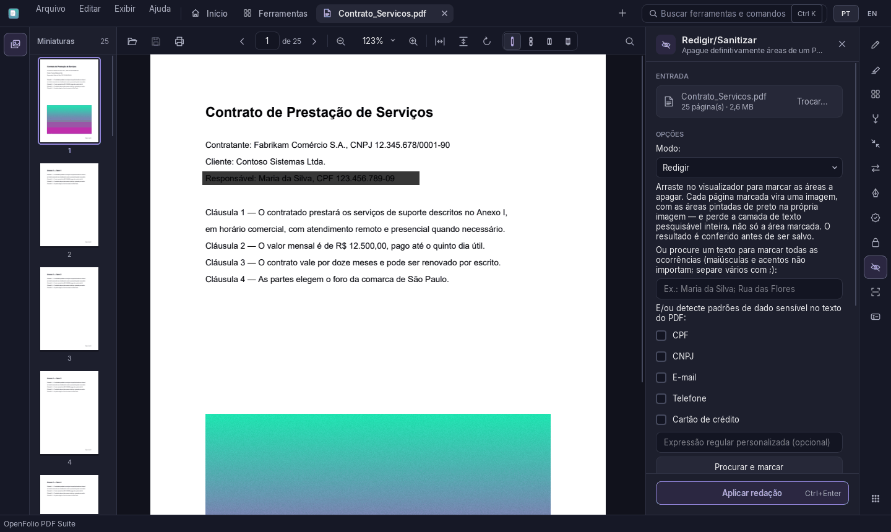
</p>

### Assinatura digital

Um termo de aceite foi assinado com um certificado de teste gerado na hora: o selo visível
aparece no canto inferior direito da página. A verificação mostra quem assinou segundo o
certificado, a data, se o conteúdo assinado continua íntegro, se algo foi alterado depois da
assinatura e se o certificado é confiável (o de teste, por ser autoassinado, aparece como
"válida, com ressalvas"):

<p align="center">
  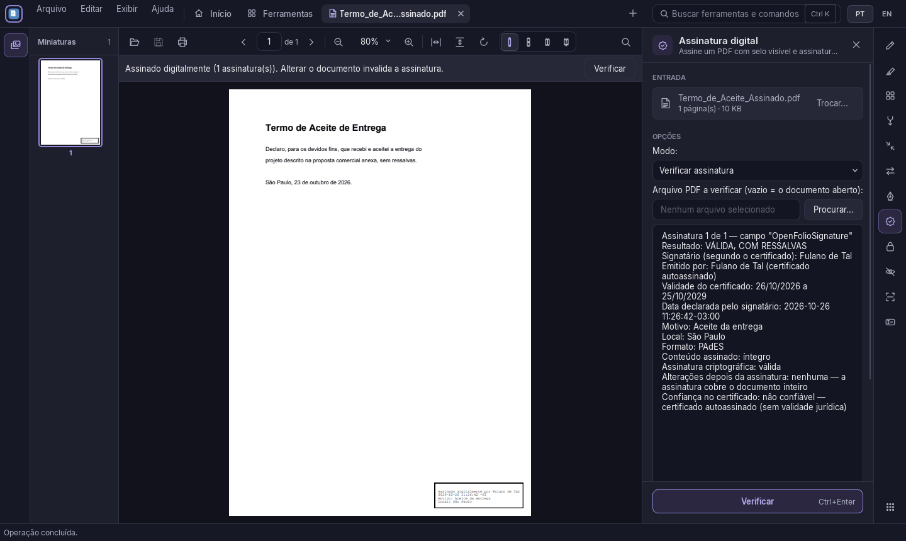
</p>

## Baixar (instalador pronto)

Quem só quer usar o programa não precisa de Python nem de `pip`: a
[página de Releases](https://github.com/dcCarreto/openfolio-pdf-suite/releases) tem um
instalador pronto para cada sistema, gerado automaticamente a partir do código deste
repositório:

| Sistema | Arquivo |
| --- | --- |
| Windows | `OpenFolioPDFSuite-Setup-<versão>.exe` — instalador com atalho no menu Iniciar e desinstalador |
| Linux | `OpenFolioPDFSuite-<versão>-x86_64.AppImage` (roda em qualquer distro, sem instalar nada) ou `openfolio-pdf-suite_<versão>_amd64.deb` (Debian/Ubuntu) |
| macOS | `OpenFolioPDFSuite-<versão>.dmg` |

Nenhum dos três é assinado digitalmente (isso exige certificados pagos que este projeto
não tem). O Windows pode avisar via SmartScreen e o macOS via Gatekeeper no primeiro
uso — isso é esperado numa release beta open source, veja como prosseguir em
[RELEASING.md](RELEASING.md#sobre-a-assinatura-de-código).

## Requisitos

- Python 3.10 ou superior
- Windows, Linux ou macOS (interface gráfica via PySide6/Qt)
- [LibreOffice](https://www.libreoffice.org/) (opcional) — se instalado, a conversão de
  Word/Excel/PowerPoint para PDF preserva a formatação original e aceita também os formatos
  antigos e os do LibreOffice. Sem ele, .docx, .xlsx e .pptx ainda são convertidos, com uma
  formatação básica (texto, títulos, listas e tabelas, via Python puro), e o app avisa o que
  ficou de fora.
- [Tesseract OCR](https://github.com/tesseract-ocr/tesseract) (opcional, necessário só para a
  ferramenta de OCR) — a aplicação detecta a instalação automaticamente e lista os idiomas de
  reconhecimento disponíveis. Instale também o idioma `por` e, para páginas digitalizadas de
  lado, o pacote `osd`.
- [Ghostscript](https://ghostscript.com/) (opcional) — comprime mais e faz a conversão
  completa para PDF/A (embutindo fontes e achatando transparência).
- [veraPDF](https://verapdf.org/) (opcional) — se instalado, a validação de PDF/A usa o
  validador de referência, além das verificações do app.

## Como instalar a partir do código-fonte

```bash
git clone https://github.com/dcCarreto/openfolio-pdf-suite.git
cd openfolio-pdf-suite
pip install -e .
```

Isso instala o pacote em modo editável junto com todas as dependências (`pypdf`, `PySide6`,
`pypdfium2`, `Pillow`, `reportlab`, `cryptography`, `python-docx`, `openpyxl`, `python-pptx`,
`pytesseract`, `pyhanko`).

## Como rodar

```bash
python main.py
```

A janela principal abre em modo escuro, com a aba **Criar PDF** selecionada por padrão. Basta
escolher a ferramenta desejada na barra lateral.

## Tecnologias utilizadas

| Biblioteca | Uso |
| --- | --- |
| [pypdf](https://pypdf.readthedocs.io/) | Leitura, escrita e manipulação de PDFs (base de quase todas as operações) |
| [PySide6](https://doc.qt.io/qtforpython/) | Interface gráfica (Qt para Python) |
| [pypdfium2](https://pypdfium2.readthedocs.io/) | Renderização de páginas PDF em imagens (visualizador, thumbnails, conversão PDF → imagem) |
| [Pillow](https://pillow.readthedocs.io/) | Leitura/escrita de imagens (conversão imagem → PDF, extração de imagens) |
| [reportlab](https://www.reportlab.com/) | Geração de conteúdo vetorial (marca d'água, numeração de página, campos de formulário, redação, fallback de conversão do Office/XML) |
| [cryptography](https://cryptography.io/) | Criptografia AES-256 usada na proteção por senha e geração do certificado de teste da assinatura digital (via `pypdf[crypto]`) |
| [python-docx](https://python-docx.readthedocs.io/) | Leitura de documentos Word (.docx) no fallback de conversão para PDF |
| [openpyxl](https://openpyxl.readthedocs.io/) | Leitura de planilhas Excel (.xlsx) no fallback de conversão para PDF |
| [python-pptx](https://python-pptx.readthedocs.io/) | Leitura de apresentações PowerPoint (.pptx) no fallback de conversão para PDF |
| [pytesseract](https://github.com/madmaze/pytesseract) | Integração Python com o Tesseract OCR |
| [pyhanko](https://github.com/MatthiasValvekens/pyHanko) | Assinatura digital de PDF (CMS/PKCS#7) e verificação de integridade |
| [LibreOffice](https://www.libreoffice.org/) (opcional, externo) | Conversão de Word/Excel/PowerPoint para PDF com formatação fiel ao original |
| [Tesseract OCR](https://github.com/tesseract-ocr/tesseract) (opcional, externo) | Motor de reconhecimento de texto usado pela ferramenta de OCR |
| [Ghostscript](https://ghostscript.com/) (opcional, externo) | Compressão mais forte e conversão completa para PDF/A |
| [veraPDF](https://verapdf.org/) (opcional, externo) | Validação de referência de PDF/A |
| [Fontes DejaVu](https://dejavu-fonts.github.io/) (incluídas) | Fonte embutida em todo texto que o app desenha nos PDFs (marca d'água, numeração, carimbos, edição de texto, OCR, XML, Office), com acentos, grego, cirílico e símbolos |
| [Compact ICC Profiles](https://github.com/saucecontrol/Compact-ICC-Profiles) (incluído, CC0) | Perfil de cor sRGB embutido nos arquivos PDF/A |

## Estrutura do projeto

```text
core/            Lógica de manipulação de PDF, sem nenhuma dependência de UI
  base.py          Classe base PDFOperation, abertura de PDFs protegidos ou com restrições,
                   gravação atômica e validações compartilhadas
  document.py      Montagem de documentos a partir de páginas sem perder metadados, anexos,
                   camadas e rótulos de página
  merge.py, split.py, pages.py, compress.py, convert.py, ...
  geometry.py      Conversão entre o espaço do PDF e o que aparece na tela (/Rotate, CropBox)
  overlay.py       Desenho sobre a página na orientação da tela (marca d'água, numeração, OCR)
  progress.py      Andamento e cancelamento das operações longas; trava de acesso ao pdfium
  messages.py      Mensagens para o usuário que a interface traduz (modelo + valores)
  fonts.py         Fontes TrueType embutidas no texto desenhado (data/fonts, DejaVu)
  external.py      Localização e execução canceláveis de LibreOffice, Ghostscript, veraPDF
  tabular.py       Exportação para CSV ou Excel protegida contra fórmulas
  pdfa.py          Conversão e verificação de PDF/A (perfil de cor em data/icc)
  rasterize.py     Achatamento de página em imagem, com áreas pintadas nos próprios pixels
  annotations.py   Anotações reais (Highlight/Underline/StrikeOut/Ink/Stamp) via pypdf
  ocr.py           Reconhecimento de texto (Tesseract) com camada de texto invisível
  redaction.py     Redação real (rasterização + verificação) e sanitização de PDFs
  signature.py     Assinatura digital (pyhanko) e verificação completa das assinaturas

ui/              Interface gráfica (PySide6)
  main_window.py       Janela principal: sidebar, visualizador e as 26 seções (cada aba é
                       construída na primeira vez em que é aberta)
  theme.py             Tema escuro único, inspirado no macOS
  icon.py              Ícone da aplicação (renderizado a partir de assets/logo.svg)
  document_session.py  Documento de trabalho: arquivo do usuário, versões, desfazer/refazer
  area_pick_state.py   Marcação de áreas no visualizador para as ferramentas
  preferences.py       Arquivos recentes, última pasta e idioma entre sessões
  app_events.py        Arquivos vindos da linha de comando, do "Abrir com" e de arrastar
  errors.py            Mensagens de erro para o usuário, com detalhes técnicos à parte
  printing.py          Impressão do documento (render do pdfium enviado à impressora)
  annotation_state.py  Estado compartilhado da ferramenta de anotações
  redaction_state.py   Estado compartilhado da ferramenta de redação
  page_ranges.py       Leitura de listas de páginas digitadas ("1-3, 5, 8-")
  tasks.py             Execução das operações numa thread de trabalho, uma por vez
  diagnostics.py       Log em arquivo e tratamento global de exceções
  widget_state.py      Preserva o que foi preenchido nas abas ao trocar de idioma
  viewer/              Visualizador central: renderização, painel lateral (miniaturas,
                       marcadores, anexos), busca, zoom, seleção de texto
  pages/               Uma classe de página por ferramenta (MergePage, CompressPage, ...)
  widgets/             Widgets reutilizáveis (FilePicker, FileListEditor, PageContainer)

tests/           Testes pytest (um arquivo por operação de core, + teste de fumaça da UI)

assets/          Ícone/logo da aplicação e screenshots usados neste README

packaging/       Empacotamento para Windows (Inno Setup), Linux (AppImage/.deb) e
                 macOS (.dmg) — veja RELEASING.md para o processo completo de release
```

Cada operação em `core/` é independente da UI: pode ser usada diretamente em um script Python,
sem precisar abrir a interface gráfica. Por exemplo:

```python
from core.merge import MergePDF

MergePDF().run(
    ["relatorio_janeiro.pdf", "relatorio_fevereiro.pdf"],
    "relatorios_consolidados.pdf",
)
```

## Testes

```bash
pip install -e ".[test]"
pytest
```

Todos os módulos de `core/` têm testes cobrindo o comportamento esperado, e há um teste de
fumaça que garante que a janela principal monta todas as seções sem erros. Um teste de
preservação passa cada operação por um PDF com sumário, metadados, anexo, formulário, rótulos
de página e camadas, e confere que nada disso se perde no caminho. Um teste de traduções
confere que todo texto da interface e toda mensagem do `core` têm versão em inglês. A suíte também
roda automaticamente a cada push em `main` e a cada pull request, em Windows, Linux e macOS
(veja [.github/workflows/ci.yml](.github/workflows/ci.yml)).

## Contribuição

Contribuições são bem-vindas. Veja [CONTRIBUTING.md](CONTRIBUTING.md) para mais detalhes.

## Licença

Distribuído sob a licença [MIT](LICENSE). As fontes DejaVu incluídas em `core/data/fonts`
têm licença própria, livre ([LICENSE-DejaVu.txt](core/data/fonts/LICENSE-DejaVu.txt)), e o
perfil de cor em `core/data/icc` é de domínio público (CC0).
